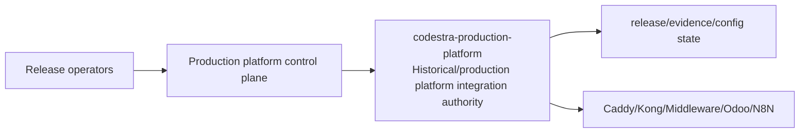
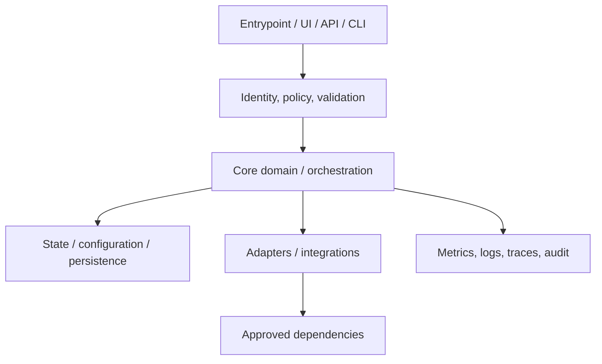
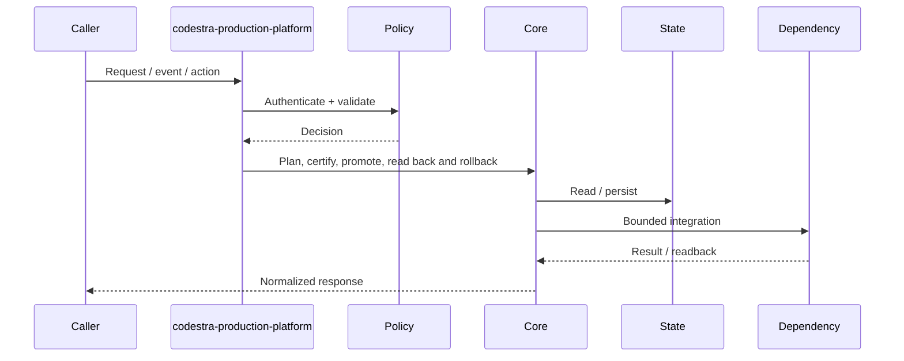
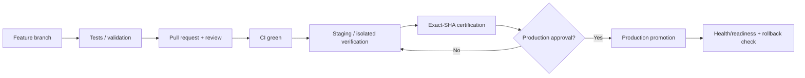
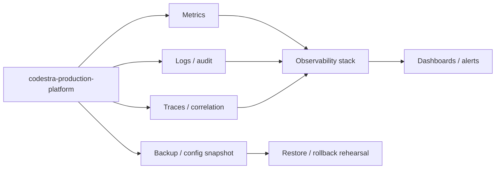

# codestra-production-platform — Architecture Charts

> Repository: `appolon1908/codestra-production-platform`  
> Baseline branch: `release/production-activation`  
> Repository-local visual architecture. Update these diagrams when implementation or authority changes.

## 1. System context

## 2. Internal component architecture

## 3. Critical flow

## 4. Deployment and promotion

## 5. Observability and recovery

## Ownership notes
- **Role:** Historical/production platform integration authority
- **Primary boundary:** Production platform control plane
- **State/config:** release/evidence/config state
- **Dependencies/consumers:** Caddy/Kong/Middleware/Odoo/N8N
- Cross-repository effects must use reviewed contracts; production effects remain separately gated.
