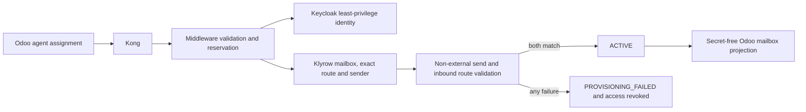
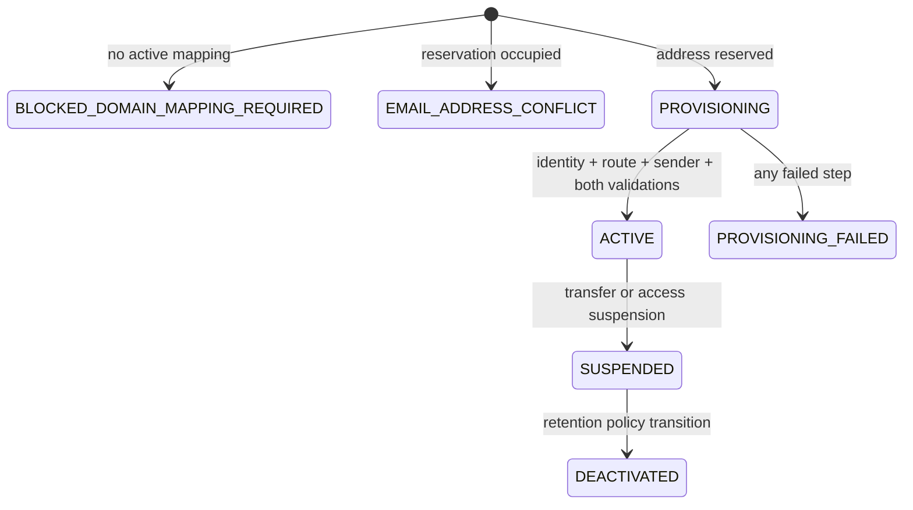

# Automatic campaign email provisioning

Odoo remains the business authority for an active agent and campaign assignment. Kong authenticates the command. The middleware `control_plane` schema owns the approved campaign-domain registry, exclusive address reservation, mailbox desired/actual state, idempotency, and audit. Keycloak owns login identity and grants only `codestra-email-agent` plus the four `.own` scopes. Klyrow owns mailbox API, inbound routes, sender authorization, durable email outbox, and Postal isolation. Postal credentials are never returned to an agent or stored in the registry.

The default local part is the transliterated first-name field with spaces and unsupported punctuation removed. A local part shorter than two characters is rejected. `tenant_id + domain + local_part` is reserved transactionally. An existing retained or active address produces `EMAIL_ADDRESS_CONFLICT`; a variation requires a separately approved command and is never guessed.

## Domain gate

A campaign must have one administrator-approved primary domain whose sender and inbound verification flags and sending/receiving gates are all true. Alias domains are informational and are never automatically selected. Missing or incomplete evidence produces `BLOCKED_DOMAIN_MAPPING_REQUIRED`. Domain activation additionally requires operational evidence for MX, SPF, DKIM, DMARC, TLS, PTR, HELO, inbound routing, outbound authorization, and ownership approval.

## Provisioning state and rollback

An exact replay returns the existing mailbox. The same key with changed immutable data returns an idempotency conflict. A failed downstream step disables both directions, removes mailbox grants, retains the reservation and safe error, and never selects another domain. Suspension disables sending and API access while retaining messages and audit history. Campaign transfer provisions a distinct address only after suspending the old sender; any inbound grace forwarding requires explicit approval.

## Authorization and routing

Outbound `From` must match an ACTIVE mailbox for the authenticated tenant, agent, and campaign. Shared addresses are separate role queues and cannot be personal mailboxes. Inbound lookup is an exact recipient match; there is no catch-all. Supervisor access requires an explicit matching campaign grant. Attachment processing must reject unsupported MIME types and excessive sizes and quarantine malware before message storage. Message and attachment storage must preserve tenant, campaign, agent, Message-ID, threading, correlation ID, immutable audit, consent, and suppression decisions.

No live delivery is part of this candidate. Domain verification, Keycloak role creation, Klyrow identity/route creation, and Odoo projection writes require protected adapter implementations and destination read-back before activation.
