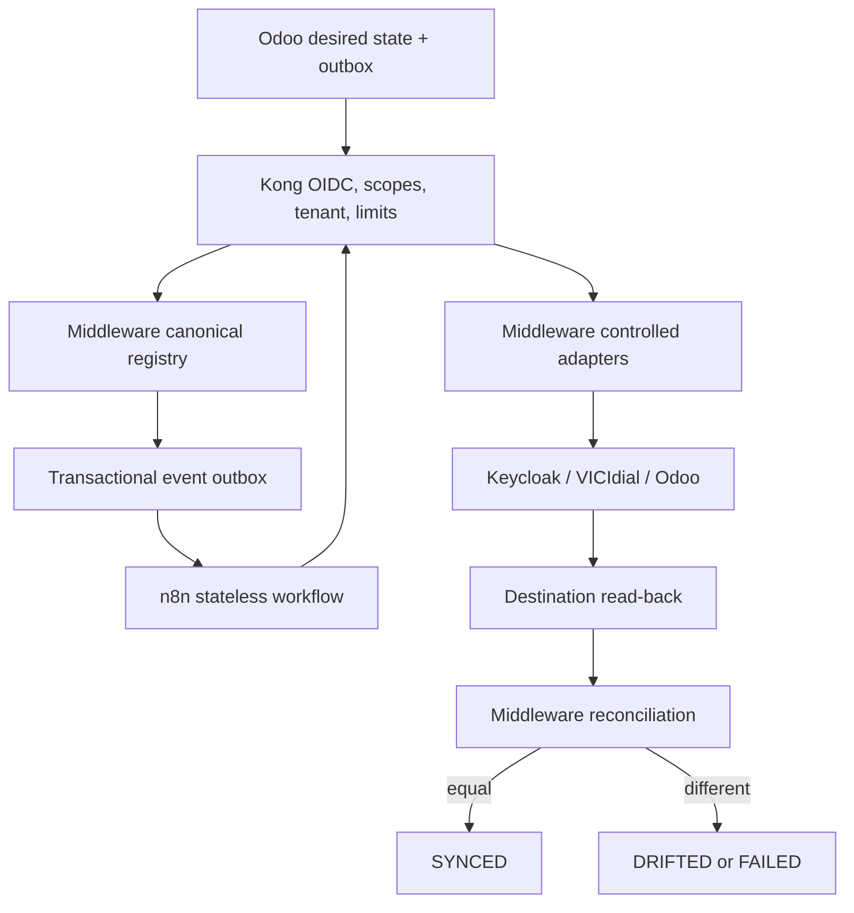

# Codestra cross-system control plane

Odoo owns business desired state. Kong is the only public authenticated and authorized API boundary. The middleware `control_plane` PostgreSQL schema owns canonical UUIDs, mappings, desired and observed state, versions, jobs, outbox events, reconciliation, dead letters, and audit. n8n is a stateless orchestration consumer. Keycloak owns authentication identity; VICIdial owns telephony runtime state; Asterisk owns SIP endpoints and media.

No HTTP acceptance or workflow completion is synchronization proof. `SYNCED` requires normalized destination read-back equality at the current entity version. Legacy Odoo mappings remain a read-only shadow until every result is reconciled.

Safety defaults remain `LIVE_PSTN_DIALING=false`, `LIVE_CALL_CONTROL=false`, `VICIDIAL_WRITE_ENABLED=false`, `VICIDIAL_WRITES_ENABLED=false`, `CALLBACK_DISPATCH_ENABLED=false`, `LIVE_SMS_DELIVERY=false`, `LIVE_EMAIL_DELIVERY=false`, and `PRODUCTION_TRANSCRIPTION=false`.
